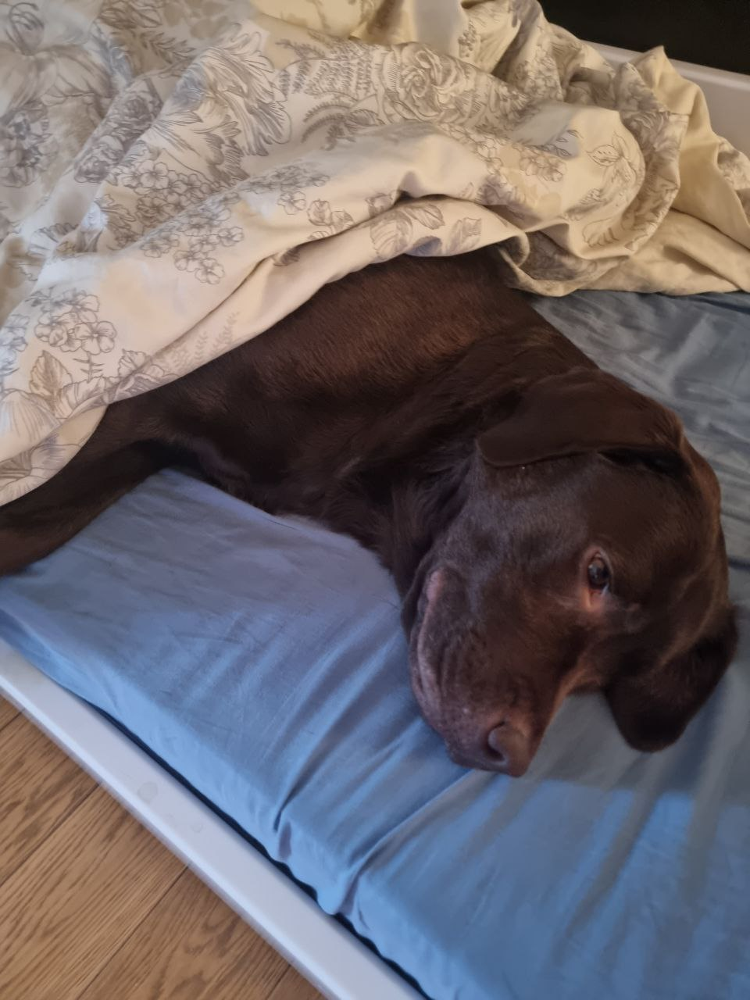
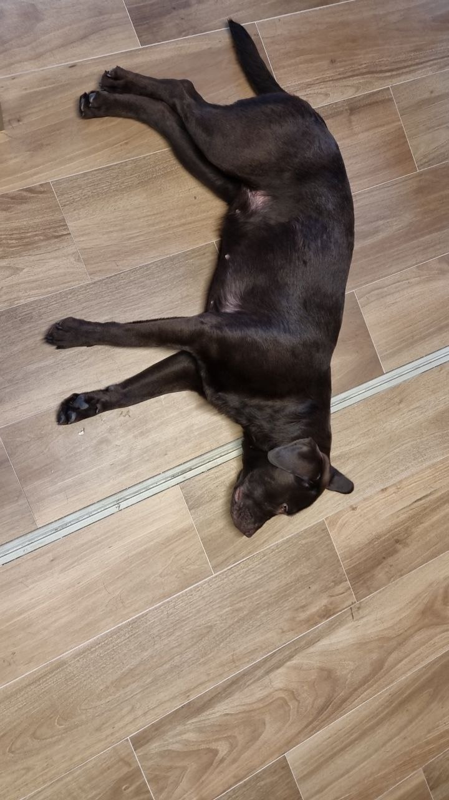
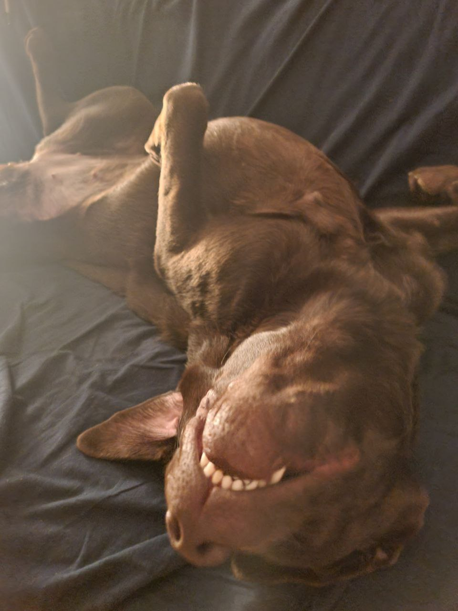

# full-stack engineer :)

**Продуктовая разработка · автоматизация · аналитические системы**

## Направления

- **Web products** — интерфейсы на React и TypeScript, API на FastAPI;
- **Automation** — парсинг, Telegram-интеграции и автоматизация рутинных процессов;
- **Data** — PostgreSQL, Redis и аналитические системы;
- **Delivery** — Docker, Nginx, Linux и развёртывание на VPS;
- **Game development** — игровые прототипы и системы на Unity / C#.

## Инструменты

  

  

  

## GitHub activity

## Собака

---

### Обсудить проект

[Telegram](https://t.me/Dog_Bobik) · [Email](mailto:1fufrik1@gmail.com) · [Kwork](https://kwork.ru/)

